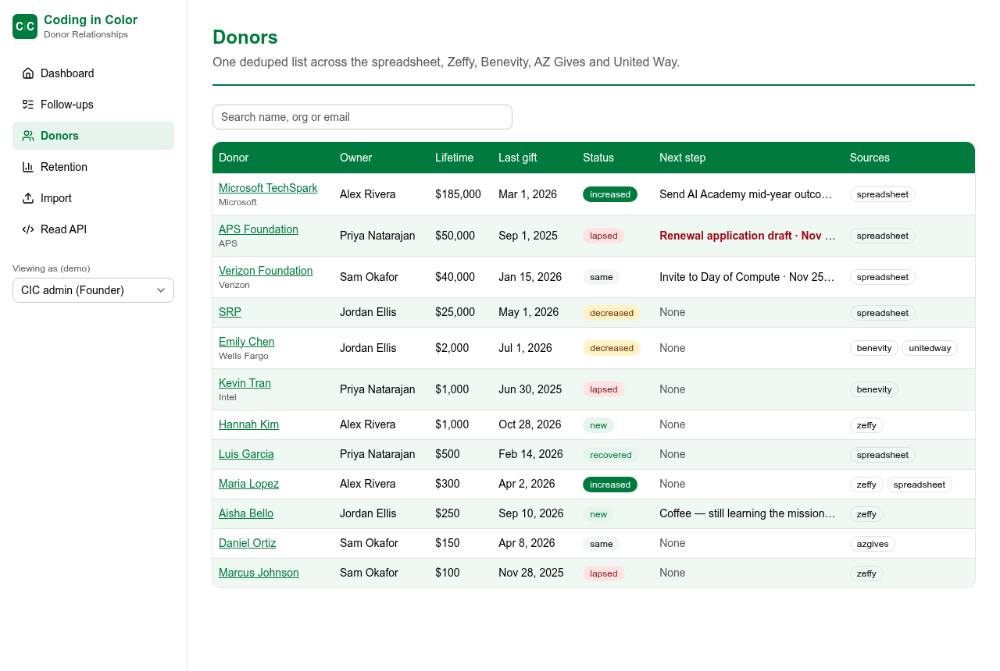

# Git Happens — Coding in Color

Built at [ASU Fall Hackathon 2026 | Phoenix Hackathon for Nonprofits: Nov 14-15](https://www.ohack.dev/hack/fall-2026) for the public good (MIT license).

> **⚠️ This is your team's ONE repository — all code goes here.** Please don't create
> another repo (personal or org). Judges, the Team Dashboard's code-activity card,
> the public project page and the nonprofit all read **this** repo; work pushed
> anywhere else is invisible to them and won't count. Everyone on the team should be
> a collaborator here — ask an organizer in Slack if someone can't push.

| | |
|---|---|
| **Nonprofit** | [Coding in Color](https://www.ohack.dev/nonprofit/YIXYdYCoxIZC08uQ5DL3) |
| **Problem statement** | [Donor & Funder Relationship Platform (CIC Problem 2)](https://www.ohack.dev/project/e26932c0df1b11f189a8dead68f07eb5) |
| **Team page** | [Git Happens](https://www.ohack.dev/hack/fall-2026/team/28a0f23ce05c11f1bd10deadfb009123) · [Team Dashboard](https://www.ohack.dev/hack/fall-2026/manageteam) (story, demo video, submit) |
| **Slack** | team: [#githappens](https://opportunity-hack.slack.com/app_redirect?channel=githappens) · nonprofit: [#npo-coding-in-color](https://opportunity-hack.slack.com/app_redirect?channel=npo-coding-in-color) · help: [#ask-a-mentor](https://opportunity-hack.slack.com/archives/C01E5CGDQ74) |
| **Created by** | Greg V [Staff/Mentor] |

## Final day

Start recording your demo video by **Sun Nov 15, 12:00 PM MST** — hacking ends at **Sun Nov 15, 2:00 PM MST**, and a demo you recorded with time to spare beats a feature you finished at 1:59.

- Sun Nov 15, 11:00 AM MST — Presentation Feedback Hour
- **Sun Nov 15, 12:00 PM MST — Start recording your demo video**
- Sun Nov 15, 12:30 PM MST — Judges Arrive
- **Sun Nov 15, 2:00 PM MST — 🛑 Submission Deadline: Hacking ends**
- Sun Nov 15, 2:05 PM MST — Judging Round 1
- Sun Nov 15, 3:40 PM MST — Judging Final Round
- Sun Nov 15, 4:30 PM MST — Closing Ceremony: Winners Announced

## Before hacking ends — the submission checklist

Everything is submitted from your [Team Dashboard](https://www.ohack.dev/hack/fall-2026/manageteam); judges read the dashboard, this README and your demo video.

- [ ] **Code pushed** to this repo, in small PRs (see `AGENTS.md`) — judges and future recruiters read the history
- [ ] **Project story** written on the dashboard (`#project`): the problem, who it helps, what you built, what's next
- [ ] **Demo video** (4 minutes or less) on YouTube, Vimeo, Loom or Google Drive, linked on the dashboard (`#demo`) — show it working, not slides
- [ ] **Submit** on the dashboard (you can keep editing until the close)
- [ ] This README filled in below: team, tech stack, how to run it, live link if you have one
- Optional: a [DevPost entry](https://opportunity-hack-2026-arizona.devpost.com/) — the dashboard is the submission of record.

Judges score **Scope, Documentation, Polish and Security**, plus a separate **Accessibility** prize — the rubric is at [ohack.dev/hackathon-judging-criteria](https://www.ohack.dev/hackathon-judging-criteria). Document your work as GitHub Issues as you go: that's how you get public credit for it.

## Team

<!-- Replace with real people; link GitHub profiles so this repo works as your portfolio -->
- [Noah Schroeder](https://github.com/n-schroeder)
- [Matthew Jurenka](https://github.com/mattjurenka)
- [Ram Bhatnagar](https://github.com/Sir-Arceebee)
- [Eleanor Lam](https://github.com/codagirlaz)

## What we built

Coding in Color's donor records are split across a spreadsheet, Zeffy and Benevity, and follow-ups depend on board members remembering them. This platform merges those sources into one deduplicated donor list, gives each board member a queue of next steps with drafted thank-yous and updates that a human approves, and shows year-over-year retention. Board members sign in with WorkOS AuthKit, and data lives in Cloudflare D1 behind a Worker API. The seed data is fake.

Each page has its own doc in [`docs/features/`](docs/features/): who uses it, what it does, edge cases and where the code is.

- **[Dashboard](docs/features/dashboard.md)**: org health, board-member load, upcoming events, recent activity
- **[Notifications](docs/features/notifications.md)**: one inbox of reminders: next steps, quarterly updates, lapsed donors, drafts, events
- **[Follow-ups](docs/features/follow-ups.md)**: next steps, quarterly touches and lapsed nudges, with AI-written drafts a human approves and sends from their own mail app
- **[My Donors](docs/features/my-donors.md)**: your donors, with CSV and Excel export
- **[All Donors](docs/features/all-donors.md)**: (admin) every donor; assign board members, filter, export
- **[Donor detail](docs/features/donor-detail.md)**: timeline, next steps, one-click event invites, debriefs and the funder packet
- **[Update Donors](docs/features/update-donors.md)**: (admin) import the spreadsheet, Zeffy and Benevity with column mapping and dedupe
- **[Retention](docs/features/retention.md)**: (admin) year-over-year retention, churn and activation patterns
- **[Program outcomes](docs/features/program-outcomes.md)**: (admin) the outcomes funder packets and updates quote
- **[Assistant](docs/features/assistant.md)**: chat about your records, debriefs by voice, buttons you press to act
- **[Search](docs/features/search.md)**: pages and donors, from any page (Ctrl+K)
- **[Events calendar](docs/features/events-calendar.md)**: CIC's calendar, so invites have real dates
- **[Use sample data](docs/features/sample-data.md)**: made-up records to try the app before an import
- **[Read API](docs/features/read-api.md)**: (admin) API keys for CIC's org dashboard, plus interactive API docs
- **[Board members](docs/features/board-members.md)**: (admin) invite, change role, remove
- **[My account](docs/features/my-account.md)**: profile, password, MFA
- **[Installable app](docs/features/installable-app.md)**: install on phones and desktops; opens offline
- **[Dev tools](docs/features/dev-tools.md)**: (admin, development only) clear the donor database; remove before launch




### Demo accounts

Sign in with any of these. They're fake accounts, and every one uses the password **`CicDemo-2026!`**:

| Email | Role |
|---|---|
| `alex@example.org`, `diana@example.org`, `mauricio@example.org`, `dominick@example.org`, `melissa@example.org` | CIC admin: every donor, plus Import, Board members and Read API keys |
| `priya@example.org`, `jordan@example.org`, `sam@example.org`, `greg@example.org`, `genevieve@example.org`, `frank@example.org`, `landon@example.org`, `nicole@example.org`, `adrian@example.org`, `amber@example.org` | Board member: only their own donors |

The password is public on purpose because the data is fake. Replace these accounts before CIC loads real donors.

### Where the logic lives

- `src/lib/dedupe.ts`: CSV parsing, per-source column mapping, union-find dedupe on email, then phone, then name+org, then name. Name-only matches are flagged for review. Gifts are deduped too: for one donor, the same amount within 3 days of a gift already recorded (or already in this import) is skipped, so re-imports and a donation reported by two sources count once. The preview lists every skipped gift.
- `src/lib/reminders.ts`: Notifications rules. Computed from current data, never stored, so a reminder clears once the work is done. Thresholds are constants at the top and in `src/data/sources.ts`.
- `src/lib/logic.ts`: suggested board member (fewest donors, spread across a batch), retention classification and patterns (cohorts, lapse rate by source and program), quarterly cadence. A donor with no board member has `ownerId: null`; D1 stores that as `owner_id = ''` because the column is `NOT NULL`.
- `src/lib/packet.ts`: the funder packet, and which program outcomes a donor's gifts funded.
- `src/lib/drafts.ts`: message templates. Invitations, updates and nudges name a real event from the calendar. They're the fallback, and the starting point the AI rewrites.
- `src/lib/ai-draft.ts`: the prompt for AI-written drafts (which kinds, the rules, the donor's facts) and the check that throws out a reply that is empty, too long, or has links or `[placeholders]`.
- `src/store.tsx`: the API client. It loads `/api/bootstrap`, and each action calls one route and reloads, so the UI always shows what D1 holds.
- `worker/openapi.ts`: the OpenAPI spec for the routes in `worker/index.ts`; update it when a route changes.
- `worker/index.ts`: the API. Every route resolves the caller first; board members can only read or write donors they own, and import is admin-only.
- `migrations/`: D1 schema. Add a new numbered file for each change; deploys apply them before the new code goes live.
- `src/data/seed.ts`: fake donors. **Never commit real donor PII.**

### Next steps

1. **Real exports**: get scrubbed Zeffy/Benevity samples from CIC and fix `COLUMN_MAP` in `dedupe.ts`.
2. **Sending**: drafts open pre-filled in the board member's own mail or Messages app today. Saving drafts straight into their mailbox (Gmail API / Microsoft Graph) needs per-user OAuth and, for Gmail, Google's app verification; sending from the app (Resend, Twilio) would come from CIC rather than the board member.
3. **Real calendar**: ask CIC for its Google Calendar's iCal address and set `CALENDAR_ICS_URL` (see [Events calendar](#events-calendar)).
4. **Outcomes from the classroom**: CIC enters program outcomes by hand today. Once the curriculum platform (Problem 1) has its read API, fill `program_outcomes` from its completion and learning-gain numbers instead.
5. **Brand**: swap the placeholder mark in `App.tsx` for the real CIC logo, and run Lighthouse (target a11y ≥ 95).

## Tech stack

- Frontend: Vite + React + TypeScript, Tailwind v4, [shadcn/ui](https://ui.shadcn.com) on [Base UI](https://base-ui.com) (`components.json` style `base-nova`). Add components with `bunx shadcn@latest add <name>`.
- Backend: a Cloudflare Worker (`worker/index.ts`) serving a JSON API under `/api/*`, next to the static app
- Database: [Cloudflare D1](https://developers.cloudflare.com/d1/) (SQLite). Schema in `migrations/`
- Auth: [WorkOS AuthKit](https://workos.com/user-management), free up to 1M users. The Worker verifies each access token with `jose` and looks the user up in the CIC organization in WorkOS, which is the source of truth for who is on the board
- APIs / services: the [OHack AI gateway](https://ai.ohack.dev) (OpenAI-compatible) for the assistant (model `muse-spark`) and for drafts (`gpt-oss-120b` at low reasoning effort, about 1.5 s a draft where `muse-spark` took 20–30 s). `POST /api/chat` sends it the caller's own scoped records, the same data `/api/bootstrap` returns, with the conversation; `POST /api/drafts` sends one donor's name, organization, gifts and the outcomes of programs they funded. **That includes donor names, emails and gifts**, so check with CIC before real donor data goes through it. The prompt puts fixed instructions and the data first and the per-caller lines last, so the gateway can cache the repeated prefix across turns and between admins; `wrangler tail` logs how many prompt tokens each reply got from the cache.

Why these models, and what a real deployment should use instead: [decision 001](docs/decisions/001-ai-model.md).

## Run it locally

Needs [Nix](https://nixos.org/download) with flakes enabled. `flake.nix` pins Bun and Node, so everyone builds with the same toolchain.

```bash
git clone https://github.com/2026-Arizona-Opportunity-Hack/Git-Happens-CodinginColor.git
cd Git-Happens-CodinginColor
nix develop          # shell with bun + node; run everything below inside it
bun install
bun run db:migrate   # create the local D1 database
bun run db:seed      # load the fake demo data (re-run any time to reset)
bun dev              # http://localhost:5173, app + API
nix build            # typecheck + production build, output in ./result
bun run test         # unit tests for src/lib, failing under 95% coverage
```

`nix build` installs dependencies from `bun.lock` in a sandbox, checked against a hash in `flake.nix`. After changing dependencies, set that hash (`x86_64-linux = "…"`) to `""`, run `nix build`, and paste the `got:` hash it prints. Other platforms need their own hash added the same way.

`bun dev` runs the Worker and a local D1 database inside Vite, through `@cloudflare/vite-plugin`. Both the Worker and `bun run db:seed` need the WorkOS Staging secret key, so copy `.env.example` to `.env` and set `WORKOS_API_KEY` before running them. The assistant also needs `AI_API_KEY`, the OHack AI gateway key from your team card; without it everything else works and the chat says it's unavailable. In production it's a Worker secret (`bunx wrangler secret put AI_API_KEY`). `.env` is gitignored.

### Tests

`bun run test` runs the unit tests in `src/lib/*.test.ts` and prints a coverage table. It then fails with `error: lines coverage is …%, under the 95% minimum` if the tests cover under 95% of the lines or functions in `src/` (`scripts/check-coverage.ts`). The **Tests** workflow runs it on every pull request and marks the PR red with that error. Every module in `src/lib` counts, tested or not (`all-modules.test.ts` loads them all), so new logic needs tests from the start. The Worker's checks and read API totals are in `src/lib/api.ts` for the same reason.

What tests each feature of [CIC's brief](https://docs.google.com/document/d/1sdlQDji23jA0LFoYbzNVHCkeG0ICE9XRQSr3xh3ntMU/edit) (Problem 2):

| Priority | Feature | Tests |
|---|---|---|
| P0 | Import spreadsheet, Zeffy and Benevity; dedupe across sources | `dedupe.test.ts` |
| P0 | Donor timeline of gifts and contacts | `logic.test.ts` |
| P0 | Board-member owner, new donors to the member with the fewest | `logic.test.ts` |
| P0 | Next steps with due dates; quarterly touch to every donor | `reminders.test.ts`, `logic.test.ts` |
| P0 | Retention year over year, churn and activation patterns | `logic.test.ts` |
| P0 | Templated thank-you, human approves every send | `drafts.test.ts`, `reminders.test.ts`, `actions.test.ts` |
| P0 | One-click funder export | `packet.test.ts`, `export.test.ts` |
| P0 | Key-authenticated read API aggregated by period, program and board member; input checks | `api.test.ts` |
| P1 | Debrief to action | `actions.test.ts` |
| P1 | Events-aware next steps (CIC's calendar) | `ical.test.ts`, `logic.test.ts`, `reminders.test.ts`, `actions.test.ts` |
| P1 | AI-drafted updates from gifts and program outcomes | `ai-draft.test.ts`, `drafts.test.ts` |
| P1 | Lapsed-donor radar and nudge | `reminders.test.ts`, `drafts.test.ts` |
| P2 | Natural-language donor questions (the assistant's buttons) | `actions.test.ts` |

Not built yet, so not tested: meeting notes in (P1, #29), the grant deadline tracker (P1, #30), the donor impact feed (P2, #31) and likelihood-to-give scoring (P2, #32). The tests cover logic, not pages: the React components and the Worker's D1 and WorkOS calls have no tests yet.

`fuzz.test.ts` throws a few hundred random inputs at the parsers and checks, from a fixed seed, so a failure is repeatable. It covers CSV export then re-import, amounts, dates, dedupe, the API input checks and totals, calendar feeds, AI drafts and the assistant's buttons. A failure prints its seed; rerun it with `FUZZ_SEED=<seed> bun test src/lib/fuzz.test.ts`, or try new inputs with any other seed.

### Sign-in (WorkOS)

The app uses the **Staging** environment of the "Coding in Color" WorkOS workspace. Its public client ID is `WORKOS_CLIENT_ID` in `wrangler.jsonc`, and the browser fetches it from `/api/config`. The secret key (`WORKOS_API_KEY`) stays on the Worker, which uses it to list the board. That environment is configured with:

- **Redirect URIs and allowed origins:** `https://githappens.jurenka.software`, `http://localhost:5173` and `http://localhost:5321`. Add any new host in both places.
- **Sign-out redirects:** the same three URLs, with `https://githappens.jurenka.software` as the default. Sign-out returns to the app's origin, and WorkOS shows an error page for any return URL not on this list.
- **Password sign-in.** Users are created in WorkOS.

- **An organization, "Coding in Color"** (`WORKOS_ORG_ID` in `wrangler.jsonc`). Its members are the board.

WorkOS is the source of truth for board members; D1 only stores donor data, keyed by WorkOS user ID. Admins manage the board on the app's **Board members** page: invite someone by email, set their role to **Admin** (sees every donor, can import) or **Member** (only their own donors), or remove them. The page is WorkOS's [Users Management widget](https://workos.com/docs/widgets/user-management). The Worker mints its token at `POST /api/widget-token`, and the widget only works for roles with the `widgets:users-table:manage` permission, which the Staging Admin role has. The WorkOS dashboard still works too: add a user to the "Coding in Color" organization with the same roles. The Worker caches the member list for 60 seconds, so changes show up within a minute. Someone who can sign in to WorkOS but isn't in the organization gets a 403.

AuthKit runs in `devMode`, which keeps the session in localStorage. That's required without a WorkOS custom domain, which costs $99/month.

### Deploying

`main` is where PRs land. To deploy, fast-forward `develop` to `main` and push:

```bash
git push origin origin/main:develop
```

Every push to `develop` deploys to **https://githappens.jurenka.software** through `.github/workflows/deploy.yml`, which builds with `nix build` and runs wrangler inside `nix develop` (a Cloudflare Worker with static assets and a D1 database, configured in `wrangler.jsonc`). Each deploy applies any new `migrations/` to the production database first. You can also run it by hand from the Actions tab.

The repo needs two Actions secrets:

| Secret | Value |
|---|---|
| `CLOUDFLARE_API_TOKEN` | API token from the "Edit Cloudflare Workers" template, scoped to the account and the `jurenka.software` zone, **plus Account → D1 → Edit** (the template leaves D1 out) |
| `CLOUDFLARE_ACCOUNT_ID` | `57cdeda067b33ff3b8def5d2b65aee9d` |

The Worker also needs the WorkOS secret key. Set it once (or whenever the key is rotated) with `bunx wrangler secret put WORKOS_API_KEY` and paste the Staging `sk_test_…` key. Without it every API call fails.

### AI security review

`.github/workflows/security-review.yml` asks a model to review a PR's diff for security problems. It runs two ways:

- **Check**: every PR gets one `muse-wonder` review, posted as a comment, when it's opened, reopened or marked ready for review. Pushing more commits doesn't re-run it, which keeps the gateway credits for real use. Drafts are skipped until they're ready. **Off for now**: turn it on with `gh variable set AI_CHECK_ALL_PRS --body true` and off again with `gh variable delete AI_CHECK_ALL_PRS`.
- **Audit**: when you ask, the review is saved as a report in [`audits/`](audits/) and opened as its own PR, with a comment on the reviewed PR linking to it. Add a label to the PR (it comes off afterwards, so add it again to re-run), or run it from the Actions tab with a PR number and model. Leave the PR number empty to audit the **whole repo** as it is on the branch you pick (`gh workflow run security-review.yml -f model=claude`); that uses the prompt in `.github/prompts/security-audit-repo.md` and gets up to 100 turns.

The OHack org doesn't let GitHub Actions open PRs (the repo setting is greyed out), so audit PRs are opened with a token in the `AUDIT_PR_TOKEN` secret: a [classic personal access token](https://github.com/settings/tokens/new?scopes=public_repo&description=Git%20Happens%20audit%20PRs) with only the **`public_repo`** scope, made by any collaborator with write access. (Fine-grained tokens need the org to approve them, and outside collaborators can't get that; classic tokens use the collaborator's own repo access.) The PRs show as opened by whoever made the token. Without it, the report is still pushed to an `audit/…` branch and the comment links to a page to open the PR in one click.

| Label | Model | Secret it needs |
|---|---|---|
| `ai-review` | Claude, on a Claude Pro/Max subscription | `CLAUDE_CODE_OAUTH_TOKEN`, from `claude setup-token` |
| `ai-review:kimi-k3` | `kimi-k3` on the OHack gateway | `OHACK_REVIEW_KEY`, a gateway key |
| `ai-review:muse-wonder` | `muse-wonder` on the OHack gateway ($4/$20 per 1M tokens, so sparingly) | `OHACK_REVIEW_KEY` |

The model can only read the checkout and run `git diff/log/show`; it gets no GitHub token, and a separate step posts its reply. The comment is advice, not a gate. The prompt is in `.github/prompts/security-review.md`.

To deploy by hand, run `bun run deploy` inside `nix develop` (it builds with `nix build` and uses wrangler, so log in with `wrangler login` first). To reset the live demo to the fake seed data, run `bun run db:seed:remote` (with `WORKOS_API_KEY` in `.env`; it maps the seed's donor owners to WorkOS users by email).

### Events calendar

The Worker reads CIC's events from an iCal (`.ics`) address and keeps the next 400 days of them in D1. Once `CALENDAR_ICS_URL` is set, the calendar is the whole list: an event taken off it disappears from the app, and next steps linked to it keep their text and due date. If the address can't be read, the app keeps the events it already has (`wrangler tail` shows `calendar sync failed`).

To switch from the demo calendar to CIC's own, in Google Calendar open **Settings and sharing** for the events calendar, then **Integrate calendar**:

- **Public calendar:** copy **Public address in iCal format** into `CALENDAR_ICS_URL` in `wrangler.jsonc` and deploy.
- **Private calendar:** the **Secret address in iCal format** works like a password, so it must not go in git. Delete `CALENDAR_ICS_URL` from `vars`, run `bunx wrangler secret put CALENDAR_ICS_URL`, paste the address, and deploy.

Locally, `bun dev` reads the same var, or set `CALENDAR_ICS_URL` in `.env`. Without it, the events are the seed's.

### Brand

Colors follow the CIC brand guidelines and live as tokens in `src/index.css`:

- Dark green `#007A3D` is the dominant color: headers, table headers and primary buttons.
- Green `#00A850` is an accent only: focus rings and the logo.
- Tint `#E6F4ED` is for table rows and callouts.
- Body type is Arial.

Primary buttons use dark green rather than `#00A850`, because white on `#00A850` is about 3.1:1 contrast and fails WCAG AA.

## Links

- Live demo: https://githappens.jurenka.software
- Demo video:
- Design / docs:

## After the hackathon

Winning teams finish the project with the nonprofit — the [Definition of Done](https://www.ohack.dev/about/completion) (deployed, nonprofit sign-off, docs, open source) is tracked on your team page. Keep the repo public and the README honest; recruiters do read these.

Need a hand this weekend? [#ask-a-mentor](https://opportunity-hack.slack.com/archives/C01E5CGDQ74) on Slack, or ask in [#githappens](https://opportunity-hack.slack.com/app_redirect?channel=githappens) and a mentor will drop in.
