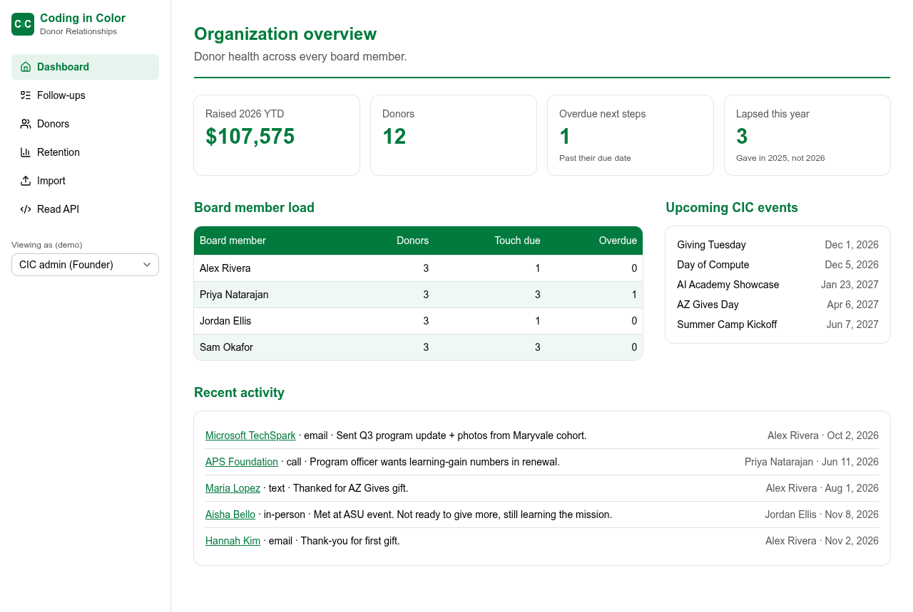

# Git Happens — Coding in Color

One donor list for Coding in Color's board. Each board member gets a queue of follow-ups and drafted thank-yous that they approve, and the board sees how many donors come back each year. Built at [ASU Fall Hackathon 2026 | Phoenix Hackathon for Nonprofits: Nov 14-15](https://www.ohack.dev/hack/fall-2026), MIT license.

| | |
|---|---|
| **Nonprofit** | [Coding in Color](https://www.ohack.dev/nonprofit/YIXYdYCoxIZC08uQ5DL3) |
| **Problem statement** | [Donor & Funder Relationship Platform (CIC Problem 2)](https://www.ohack.dev/project/e26932c0df1b11f189a8dead68f07eb5) |
| **Live site** | [githappens.jurenka.software](https://githappens.jurenka.software). Sign in with a [demo account](#demo-accounts); the data is fake |
| **Demo video** | _link coming_ |
| **API docs** | [githappens.jurenka.software/api/docs](https://githappens.jurenka.software/api/docs) |
| **Team** | [Noah Schroeder](https://github.com/n-schroeder) · [Matthew Jurenka](https://github.com/mattjurenka) · [Ram Bhatnagar](https://github.com/Sir-Arceebee) · [Eleanor Lam](https://github.com/codagirlaz) · [team page](https://www.ohack.dev/hack/fall-2026/team/28a0f23ce05c11f1bd10deadfb009123) |
| **Slack** | team: [#githappens](https://opportunity-hack.slack.com/app_redirect?channel=githappens) · nonprofit: [#npo-coding-in-color](https://opportunity-hack.slack.com/app_redirect?channel=npo-coding-in-color) |



**Judges:** the next four sections answer the [judging criteria](https://www.ohack.dev/hackathon-judging-criteria) in order: [Scope](#scope-the-problem-and-who-it-helps), [Documentation](#documentation-can-someone-else-run-it), [Polish](#polish-can-cic-use-it-today) and [Security](#security-who-can-see-what), plus [Accessibility](#accessibility). **CIC's developer:** skip to [Getting it running](#for-cics-developer-getting-it-running).

## Scope: the problem and who it helps

### The problem

Coding in Color teaches coding to students of color, and its donors fund that work. Right now its donor records are split across a spreadsheet, Zeffy and Benevity, and follow-ups only happen if a board member remembers them. When a donor isn't thanked or updated, they often don't give again the next year.

The users are CIC's board, about 15 people. Admins see every donor; each board member sees only the donors assigned to them. ### What we built

Every page has a feature doc in [`docs/features/`](docs/features/):

- **[Update Donors](docs/features/update-donors.md)** (admin): import the spreadsheet, Zeffy and Benevity exports. You map the columns, and duplicate donors across the three sources are merged into one list.
- **[Follow-ups](docs/features/follow-ups.md)**: next steps, quarterly updates and nudges for lapsed donors. AI writes a draft, and a person approves it and sends it from their own mail app.
- **[Retention](docs/features/retention.md)** (admin): year-over-year retention and churn, broken down by source and program.
- **[Donor detail](docs/features/donor-detail.md)**: a donor's timeline and next steps, one-click invites to events, debriefs and a funder packet.
- **[Dashboard](docs/features/dashboard.md)**, **[Notifications](docs/features/notifications.md)**, **[My Donors](docs/features/my-donors.md)**, **[All Donors](docs/features/all-donors.md)**: what needs attention, and who owns which donor. Lists export to CSV and Excel.
- **[Assistant](docs/features/assistant.md)**: chat about your own records, record a debrief by voice, and act through buttons you confirm.
- **[Events calendar](docs/features/events-calendar.md)**, **[Search](docs/features/search.md)** (Ctrl+K), **[Board members](docs/features/board-members.md)**, **[Read API](docs/features/read-api.md)**, **[My account](docs/features/my-account.md)**, **[Installable app](docs/features/installable-app.md)**.

### What made it hard

- **Merging donors from three sources.** The sources don't share IDs and spell names differently. Dedupe merges donors on email, then phone, then name + organization. Name-only matches are flagged for a person to check, and gifts reported by two sources count once (`src/lib/dedupe.ts`).
- **Retention.** Each donor is classified per year or quarter as new, increased, same, decreased, lapsed or recovered, with cohorts and lapse rates by source and program (`src/lib/logic.ts`).
- **AI that never sends anything.** Drafts are grounded in each donor's gifts, notes and past contact. Nothing goes out until a person approves it, and the assistant only sees the caller's own records.
- **Each P0–P2 requirement in CIC's brief** maps to the code and tests that cover it ([Testing](docs/testing.md)).

## Documentation: can someone else run it?

Setup, deploy and every environment variable are in [Getting it running](#for-cics-developer-getting-it-running) below. Everything else is in `docs/`:

| Doc | For |
|---|---|
| [docs/features/](docs/features/) | What each page does, who it's for, edge cases, where the code and tests are |
| [Architecture](docs/architecture.md) | How the Worker, D1, WorkOS and the AI gateway fit together |
| [Operations](docs/operations.md) | Every setting and secret, deploying, sign-in setup, the calendar, resetting the demo |
| [Security](docs/security.md) | Who can see what, every audit finding and its fix, known gaps |
| [Testing](docs/testing.md) | Running the tests, the coverage gate, which test covers which feature |
| [Decisions](docs/decisions/) | Why it's built this way: AI model, Cloudflare + D1, WorkOS, drafts opening in the mail app, the session cookie |
| [API reference](https://githappens.jurenka.software/api/docs) | Generated from `worker/openapi.ts` |

### How the docs stay current

- **Docs can't drift from the code.** Each doc lists the files it covers in its frontmatter. The **Docs** CI check fails a PR that changes covered code without updating its doc, and fails on any page, module or setting that no doc covers ([How these docs work](docs/README.md)).
- **`bun run docs:which <file>`** names the doc to read before you change a file.
- **The app explains itself.** Empty states say what to do next. Admin-only pages are hidden from members, and the server refuses those routes to members too.
- **History.** The work is recorded as small PRs and GitHub Issues, one per task or decision.

## Polish: can CIC use it today?

### What works now

- **Deployed** at [githappens.jurenka.software](https://githappens.jurenka.software). Every push to `develop` builds and deploys through GitHub Actions and applies database migrations first.
- **Works end to end.** You can import a file, merge duplicates, assign donors, approve a draft, open it in your mail app, log the contact and see retention update.
- **Edge cases are handled.** Empty lists, bad uploads, impossible calendar dates, a missing AI key (drafts fall back to templates), and a donor with no email or phone (no draft is offered).
- **Installable** on phones and desktops, and it opens offline.

### What's left before real use

Here is what's still unfinished. More detail is in [Security → Known gaps](docs/security.md#known-gaps).

1. **Real exports.** Get scrubbed Zeffy and Benevity samples from CIC and adjust `COLUMN_MAP` in `src/lib/dedupe.ts`.
2. **Replace the demo accounts** before real donors are loaded. The password is public on purpose.
3. **Real calendar.** Set `CALENDAR_ICS_URL` to CIC's Google Calendar ([Events calendar](docs/operations.md#events-calendar)).
4. **Sending from the app.** Today drafts open pre-filled in the board member's own mail or Messages app. Saving them straight to Gmail or Outlook needs per-user OAuth, and for Gmail, Google's app verification.
5. **Classroom outcomes.** Once the curriculum platform (Problem 1) has a read API, add students served and learning gains to funder packets.

## Security: who can see what

### Protecting donor data

- **Every donor route needs a signed-in board member** (WorkOS AuthKit). The session is an encrypted HttpOnly cookie, never in localStorage ([decision 006](docs/decisions/006-session-cookie.md)). Someone who can sign in to WorkOS but isn't in CIC's organization gets a 403.
- **No secrets in git.** Keys live in `.env` locally and in Worker secrets in production. A hook blocks commits that contain keys or `.env` files. [`.env.example`](.env.example) lists what's needed.
- **Input is validated, and every SQL query uses bound parameters.** 4,500 seeded fuzz inputs run against import, dedupe, the Excel export, the API input checks, the calendar parser, AI drafts and the assistant's buttons on every PR. They found two real bugs, both fixed with regression tests ([#84](https://github.com/2026-Arizona-Opportunity-Hack/Git-Happens-CodinginColor/pull/84), [#128](https://github.com/2026-Arizona-Opportunity-Hack/Git-Happens-CodinginColor/pull/128)).
- **The read API returns totals only**, with no names, emails or IDs. D1 stores only the SHA-256 of each API key.
- **AI security audits in CI.** A label on a PR (`ai-review`, `ai-review:kimi-k3`, `ai-review:muse-wonder`) gets it reviewed by a model. Run without a PR number, it audits the whole repo. The reports are in [`audits/`](audits/). Four audits ran on Nov 15, and muse-wonder found two issues:
  - Prompt injection from donor text. Mostly fixed in [#95](https://github.com/2026-Arizona-Opportunity-Hack/Git-Happens-CodinginColor/pull/95); the rest is tracked in [#93](https://github.com/2026-Arizona-Opportunity-Hack/Git-Happens-CodinginColor/issues/93).
  - Dev tools that could clear every donor. Removed.
- **95% coverage gate.** Every PR runs the typecheck and unit tests, and it fails if coverage of `src/` drops under 95%. Coverage is about 98% today.

### Roles

- **Two roles, set in WorkOS.** *Admin* sees every donor and can import, assign donors, manage the board and issue API keys. *Member* sees only the donors assigned to them.
- **Enforced on the server, not just hidden in the UI.** Every donor route filters by `owner_id` for members, and admin routes call `requireAdmin` (`worker/index.ts`). A member's browser never receives another member's donors.
- **Known gaps** are listed in [Security](docs/security.md#known-gaps): no rate limit on the AI routes yet, and the AI gateway sees donor data.

## Accessibility

- Pages are built from Radix and Base UI components, which are keyboard-navigable and labelled for screen readers. Icon-only buttons have `aria-label`s.
- Primary buttons use dark green instead of CIC's `#00A850`, because white on `#00A850` is about 3.1:1 contrast and fails WCAG AA.
- Debriefs can be dictated instead of typed.
- Still to do: a Lighthouse pass, targeting an accessibility score of 95 or higher.

## Demo accounts

Every demo account uses the password **`CicDemo-2026!`**. They're fake.

| Email | Role |
|---|---|
| `alex@example.org`, `diana@example.org`, `mauricio@example.org`, `dominick@example.org`, `melissa@example.org` | Admin: every donor, plus Import, Board members and Read API keys |
| `priya@example.org`, `jordan@example.org`, `sam@example.org`, `greg@example.org`, `genevieve@example.org`, `frank@example.org`, `landon@example.org`, `nicole@example.org`, `adrian@example.org`, `amber@example.org` | Board member: only their own donors |

---

# For CIC's developer: getting it running

This part is for whoever runs this for Coding in Color after the hackathon. It's Vite + React + TypeScript, served by one Cloudflare Worker with a Cloudflare D1 (SQLite) database. WorkOS AuthKit handles sign-in, and the OHack AI gateway writes the drafts and runs the assistant. [Architecture](docs/architecture.md) has the details.

## What you need

| Account | For | Cost |
|---|---|---|
| [Cloudflare](https://dash.cloudflare.com) | Hosting (Worker) and the database (D1) | Free tier is enough |
| [WorkOS](https://workos.com) | Sign-in and the board member list | Free up to 1M users |
| AI gateway key | Drafts and the assistant. Optional: without it, drafts use templates and the chat says it's unavailable | Gateway credits |
| [Nix](https://nixos.org/download) with flakes enabled | Pins Bun and Node, so everyone builds with the same toolchain | Free |

## 1. Run it on your machine

```bash
git clone https://github.com/2026-Arizona-Opportunity-Hack/Git-Happens-CodinginColor.git
cd Git-Happens-CodinginColor
nix develop          # shell with bun + node; run everything below inside it
bun install
cp .env.example .env # then fill in WORKOS_API_KEY (and AI_API_KEY if you have one)
bun run db:migrate   # create the local D1 database
bun run db:seed      # load the fake demo data (re-run any time to reset)
bun dev              # http://localhost:5173, app + API
```

`bun dev` runs the Worker and a local D1 database inside Vite (`@cloudflare/vite-plugin`). Sign in with a [demo account](#demo-accounts). `.env` is gitignored; never commit it.

## 2. Check your changes

```bash
bun run test         # unit + fuzz tests; fails under 95% coverage
nix build            # typecheck + production build, output in ./result
bun run docs:which src/pages/FollowUps.tsx   # which doc to update with a file
```

CI runs the same checks on every PR, plus the docs check. If you change dependencies, set the `x86_64-linux` hash in `flake.nix` to `""`, run `nix build`, and paste the `got:` hash it prints.

## 3. Move it to CIC's own accounts

The live site runs on a team member's Cloudflare account and a staging WorkOS environment. To take it over:

1. **WorkOS.** Create a production environment with password sign-in and an organization for CIC. Add your site's URL to the redirect URIs, allowed origins and sign-out redirects. Create **Admin** and **Member** roles; Admin needs the `widgets:users-table:manage` permission. Then put the new client ID and organization ID in `WORKOS_CLIENT_ID` and `WORKOS_ORG_ID` in `wrangler.jsonc`. ([Sign-in setup](docs/operations.md#sign-in-workos))
2. **Cloudflare.** Run `bunx wrangler login` and `bunx wrangler d1 create githappens`, and put the new `database_id` in `wrangler.jsonc`. Change `routes` to your own domain, or delete it to use the free `*.workers.dev` address.
3. **Secrets.** Run `bunx wrangler secret put WORKOS_API_KEY`, and `AI_API_KEY` if you use AI.
4. **Deploy.** Run `bun run deploy`. It builds, applies migrations to the remote database and deploys.
5. **Automatic deploys (optional).** Add `CLOUDFLARE_API_TOKEN` (with D1 edit rights) and `CLOUDFLARE_ACCOUNT_ID` as GitHub Actions secrets. Every push to `develop` then deploys ([Deploying](docs/operations.md#deploying)).
6. **Before real donors go in:** don't seed the demo data, invite the real board from the **Board members** page, set `CALENDAR_ICS_URL`, and read [Security → Known gaps](docs/security.md#known-gaps).

Every setting and secret is in the table in [Operations](docs/operations.md#settings-and-secrets).

## 4. Where to make changes

- Pages are in `src/pages/`. The logic behind them (dedupe, retention, drafts, exports) is in `src/lib/`, with tests next to each file.
- The API is `worker/index.ts`, and its OpenAPI spec is `worker/openapi.ts`.
- Database changes go in a new numbered file in `migrations/`.
- Read the doc for a file before you change it, and update the doc in the same PR. [How these docs work](docs/README.md) explains it, and coding agents should start with [AGENTS.md](AGENTS.md).

Questions: [#npo-coding-in-color](https://opportunity-hack.slack.com/app_redirect?channel=npo-coding-in-color) on the OHack Slack, or open a GitHub Issue.
